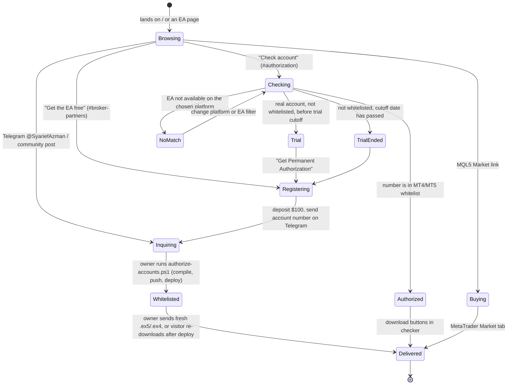
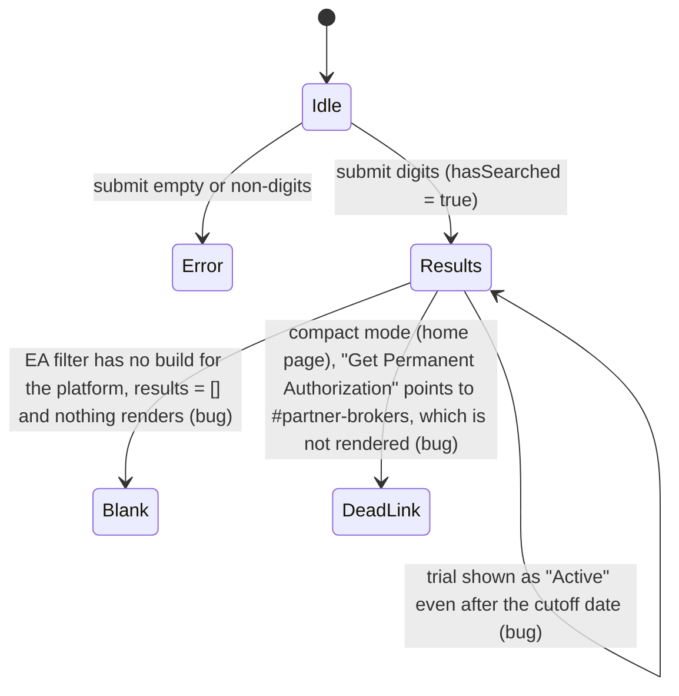
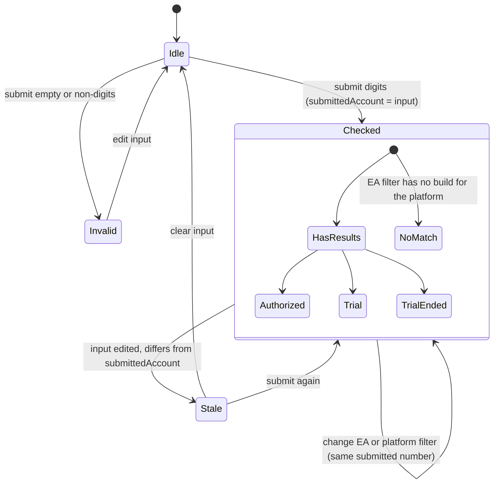
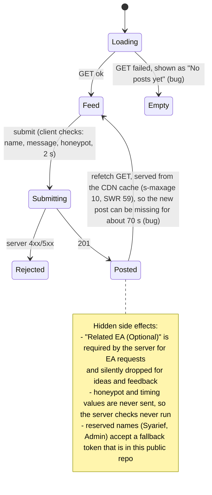
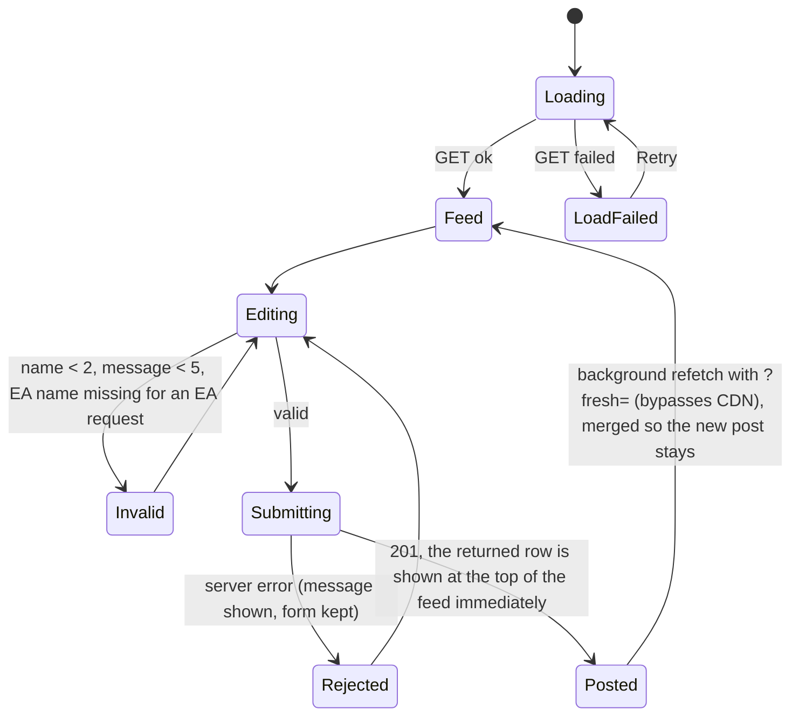
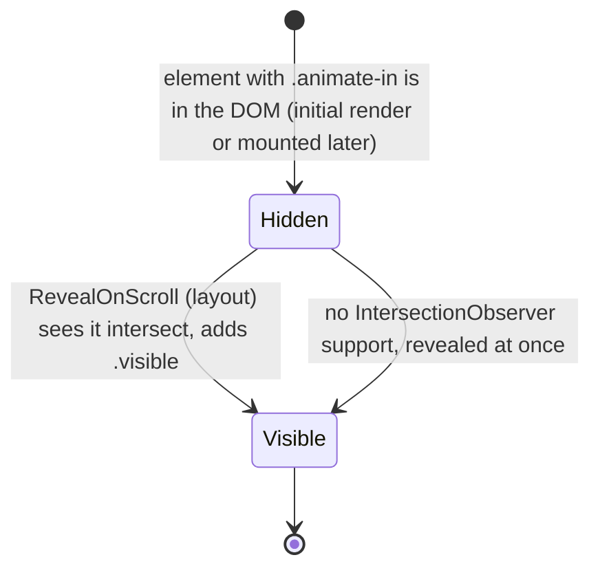
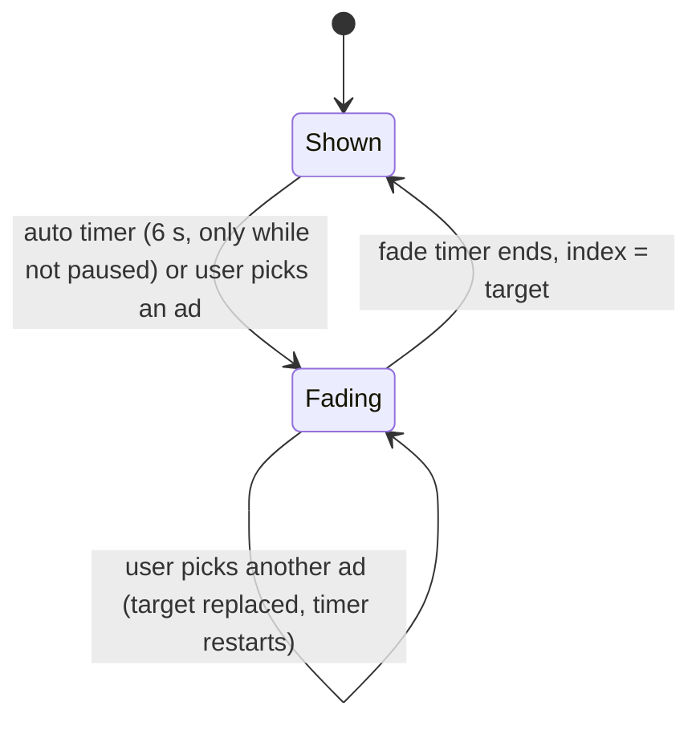
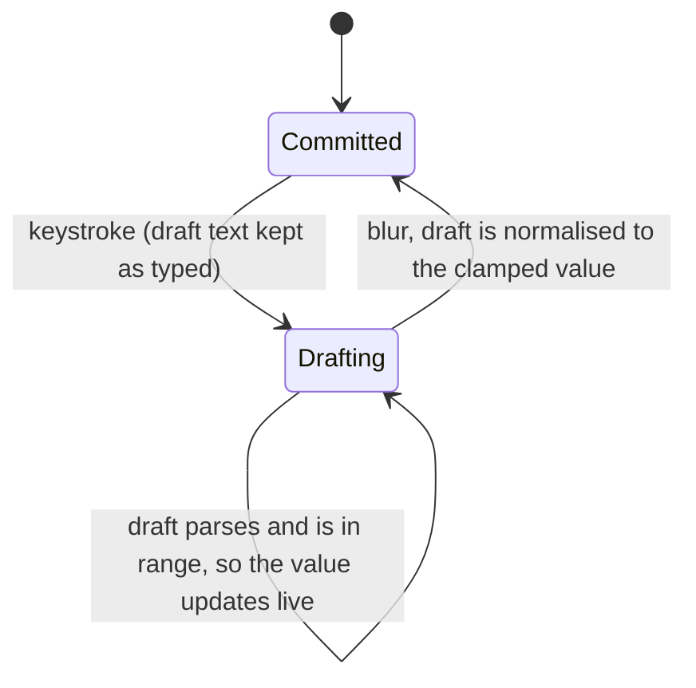
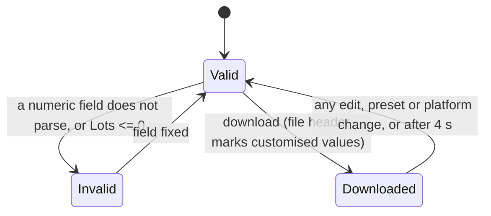

# eabudakubat.com state flows

These diagrams cover how a visitor moves from browsing to an EA inquiry to getting an EA file, and the UI state behind each step. The `Before` diagrams show what the code did up to 2026-11-12, with the bugs marked. The `After` diagrams show the behaviour the code has now.

The live site is served from Vercel at `https://eabudakubat.com`. Pages are client components that read static data from `lib/` and two API routes (`/api/comments`, `/api/products`), which use the Supabase project `qthjikwteugfowlflkfi`.

## 1. Visitor journey

Rules that hold across the journey:

- A whitelisted account is permanent. Only unauthorized real accounts carry the trial cutoff (`TRIAL.expiryDate` in `lib/authorizedAccounts.js`). Demo accounts never expire.
- A binary only knows the accounts that were whitelisted when it was compiled. After `Whitelisted`, the visitor must get a file built after that point (AGENTS.md, "Send the fresh binary").
- Every download link on the site is built from `TRIAL.expiryDate`, so the monthly expiry update changes one value instead of editing each URL by hand.

## 2. License checker (`app/components/AccountChecker.js`)

### Before

### After

- Results always belong to `submittedAccount`. The header names that number. When the input differs, a hint tells the visitor to press Check Status.
- `NoMatch` explains which platform the EA supports, instead of rendering nothing.
- `authorizeHref` points the trial CTA at the section the host page actually renders (`#broker-partners` on the home page).

## 3. Community post, which is where inquiries arrive (`app/community/page.js`, `app/api/comments/route.js`)

### Before

### After

- The EA name field appears only for "Request EA", and it is required there. That matches what the server stores and shows.
- The client sends `bot_catch` and `form_elapsed_ms`. The server checks elapsed time measured in the browser, so clock skew between visitor and server cannot reject a real post.
- Reserved names work only with `ADMIN_COMMENT_TOKEN` from the Vercel environment. With no token set, reserved names are always refused.
- Reactions are labelled as saved on this device, since they never leave the browser.

## 4. Scroll reveal (`.animate-in`)

### Before

Every page ran its own IntersectionObserver once, on mount. An element with `.animate-in` that mounted later stayed at `opacity: 0` for good:

- `/tools`: the Preset Studio and Margin Calculator tabs mount on tab switch, so both were blank. Verified on the live site on 2026-11-12.
- The simulator's "Basket take profit realized" badge carries `.animate-in` plus its own bounce animation. Once the bounce ends, `.animate-in` hides it again, so it only flashed for 0.4 s.

### After

`app/components/RevealOnScroll.js` is mounted once in `app/layout.js`. A MutationObserver picks up elements that mount later, so pages no longer carry their own observer.

## 5. Rotating broker banner (`app/components/RotatingAdBanner.js`)

### Before

The index, the fade state and two timers that share one ref were managed separately. If the mouse entered during the 250 ms fade-out, the pause cleared the pending timeout, so the banner stayed faded out (invisible) under the cursor. A pill click during an auto-advance could be skipped.

### After

A pause only stops the 6 s auto timer. A fade that has started always completes.

## 6. Number fields in the grid calculator (`app/components/GridCalculator.js`)

### Before

`onChange` clamped to the minimum on every keystroke. Typing `5000` into the balance gave `10000` (verified live): "5" was raised to 10, then the zeros were appended. The risk table then shows a balance twice the intended size.

### After

## 7. Preset (.set) download (`app/components/SetGenerator.js`)

### Before

Free-text fields went straight into the file, so `Lots=` or `Lots=abc` could be written. MetaTrader reads that as 0, and the EA never trades. "✓ Downloaded" stayed on after later edits, and the file header named the preset even when its values had been changed.

### After

## 8. Copy buttons (partner codes, MQL5 link, Quest passport)

### Before

`navigator.clipboard.writeText` was called without awaiting it, and "Copied!" was shown even when the write failed. In-app browsers without the Clipboard API, such as Facebook and Telegram, either did nothing (Headway page) or showed a false "Copied!". Overlapping timers cleared the label early.

### After

`lib/clipboard.js` has `copyText()`, which falls back to a hidden textarea and resolves `true` or `false`. `lib/useFlash.js` keeps a single timer per button. Each button shows "Copied" only after a successful write, and otherwise asks the visitor to copy the code by hand.

## 9. Other fixes

| Area | Problem | Fix |
|---|---|---|
| Facebook Pixel `Lead` | Any button whose text contained "download" counted as a lead, including FAQ questions. A .set download counted twice (button, then the generated link). | Only links (`<a>`) count, matched by file type or `download` attribute. |
| Command palette | ArrowDown with no matches set the selection to `NaN`. | The index is clamped, and reset when the palette opens. |
| EA page parameters | `RSI_TF` default listed as `PERIOD_M15`. The v1.67 source uses `PERIOD_H1`. | Text corrected. |
| Forex Quest Blitz | The "next question" timeout from a finished game could replace the first question of a new game. | Pending timeouts are cleared on start, finish and unmount. |
| Grid calculator, XAUUSD | A pip was treated as a $0.10 move at $10 per lot. EA v1.67 (and the Preset Studio's gold preset) use a $0.01 pip on 2- and 3-digit gold, so gold distances and drawdown did not match the EA's inputs. | $0.01 pip, $1 per 1.00 lot. The hint explains that the EURUSD defaults make a very tight gold grid. |
| `/api/comments` limits | The per-IP limiter lives in memory, so each serverless instance has its own copy and it resets on cold start. | `lib/commentLimits.js` reads the comments table: at most 8 posts site-wide per 10 minutes (429), and the same message within 24 hours is refused (409, which also stops double posts). Query errors fail open. |

## Comment board security (done 2026-11-13)

- `ADMIN_COMMENT_TOKEN` is set in Vercel (Production, sensitive). The local copy is in the git-ignored `.env` at the repo root. The community form never sends it, so posting as "Syarief (Creator)" means a POST to `/api/comments` with `admin_token` in the body. The old fallback value is public in git history, so treat it as burned.
- Direct inserts are closed. The route inserts with the public anon key, and the old policy `guestbook_public_insert` let anyone with that key insert rows directly, skipping every check in `/api/comments`. Now only the server and the database share a secret:
  - `lib/supabaseServer.js` sends `x-comments-key: <COMMENTS_INSERT_KEY>` on every request. `COMMENTS_INSERT_KEY` is a Vercel Production server variable (sensitive, never `NEXT_PUBLIC_`), with a local copy in the root `.env`.
  - In the database, `private.app_settings` (row `comments_insert_key`) holds the same value, and `private.comments_insert_allowed()` (security definer) compares it with the request header. The INSERT policy `comments_insert_via_site_api` uses that function. The SELECT policy `guestbook_public_read` is unchanged, since the feed needs it.
  - Verified live: a post through the site returns 201, and a direct REST insert with the anon key returns 401.

  To rotate the key, change the Vercel variable and the `private.app_settings` row together, then redeploy. Posts fail while the two differ. To undo, create an anon INSERT policy `with check (true)` and drop `comments_insert_via_site_api`. Without `COMMENTS_INSERT_KEY` in Vercel, every post fails with an RLS error.
